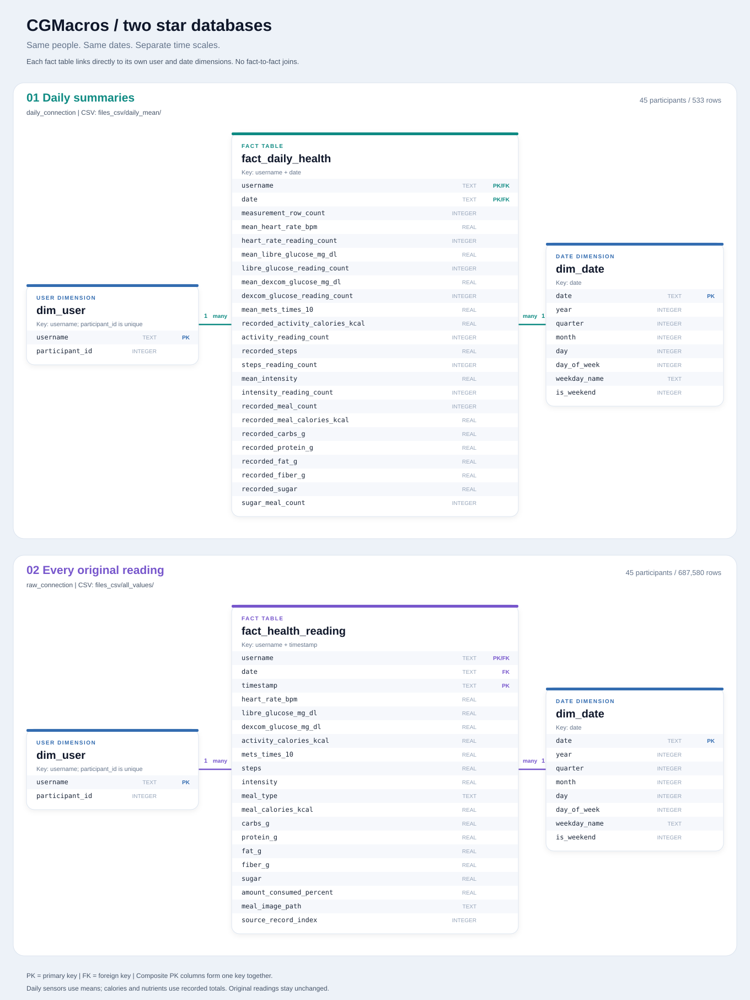
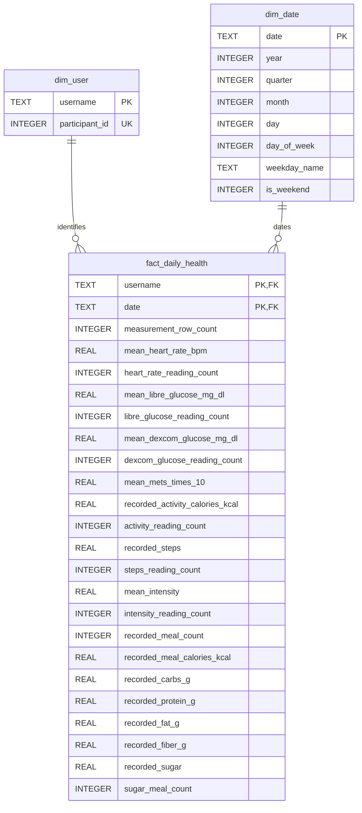
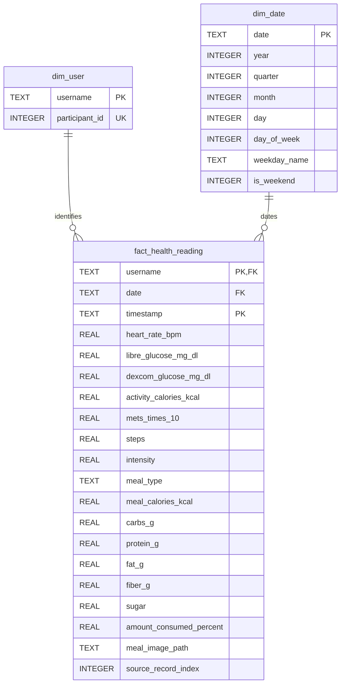

# CGMacros: two separate star databases

[Open the interactive plot](database_schema.html) or [open the SVG](database_schema.svg).
Regenerate both from the actual SQLite definitions with `python docs/render_schema.py`.



Both databases load every participant and every day available in CGMacros by
default. They have identical user/date dimensions, but different fact-table grains.
Each database stays in memory and can be queried independently.

| Database | Connection variable | Fact table | One row represents | CSV folder |
| --- | --- | --- | --- | --- |
| Daily | `daily_connection` | `fact_daily_health` | One person on one date | `files_csv/daily_mean/` |
| All values | `raw_connection` | `fact_health_reading` | One person's original timestamped reading | `files_csv/all_values/` |

## Daily star schema

`fact_daily_health` contains one row per user per recorded calendar date, keyed by
`(username, date)`. Both keys reference their dimensions directly. Open this file
in a Markdown preview that supports Mermaid to see the diagram.



## All-values star schema

The second database stores the original sensor values and meal fields without
averaging or summing. Its primary key includes a timestamp, so all readings on
the same day remain separate. Sparse meal fields remain missing between meals.



## Reading the data

`PK` means primary key, `FK` means foreign key, and `UK` means unique key.
The two fact-table primary-key columns form a single composite key.
Each dimension row can relate to many daily facts; every fact requires one user
and one date.

The source is anonymous: usernames such as `participant_001` are generated from
participant IDs. Calendar attributes describe the dataset's shifted dates, not
the original collection dates. Weekdays use Monday = 0 through Sunday = 6.

Daily averages ignore missing readings. Counts show how many readings were
recorded. Missing measurements and nutrient totals remain SQL `NULL`; zero
recorded meals means no meal was logged, not that the person ate nothing.
Calorie and nutrient sums cover only recorded data, which can include partial
days. `mean_mets_times_10` retains the source's MET scale multiplied by ten.
For multi-day averages, weight daily means by their corresponding reading counts.
Optional step, intensity, and sugar fields are retained where the source supplies
them. Intensity and sugar use the original source scale; units are not inferred.
Days without those fields remain missing, with zero supporting reading counts.

Both databases stay in memory. Minute-level readings and individual meal details
remain available in `raw_health_measurements_df` / `all_values_df`; daily statistics
are available in `daily_summary_df` / `daily_mean_df`.

```powershell
python -i docs/database.py
```

Inspect `dim_user_df`, `dim_date_df`, and `fact_daily_health_df` interactively.
`daily_summary_df` joins the daily facts to `dim_user` so it includes both the
original `participant_id` and its generated `username`, matching the measurement
and nutrition DataFrames. All DataFrames come from one loaded sample and use
the same daily-summary calculation.

All daily analysis DataFrames and CSVs have the same daily grain and the same
`(participant_id, username, date)` keys:

| DataFrame / CSV | Values per person per recorded day |
| --- | --- |
| `health_measurements` and `daily_summary` | All daily means, totals, and counts |
| `heart_rate` | Mean heart rate and reading count |
| `glucose` | Mean glucose and reading count per device |
| `activity` | Total recorded activity calories, mean METs times ten, and reading count |
| `nutrition` | Total recorded meal calories/macronutrients and meal count |

The `raw_*` DataFrames and `all_values/*.csv` contain original minute readings and
meal events, keyed by participant and timestamp. The raw modality CSVs retain the
same timestamp grid, including missing values. Each daily table retains every recorded person/date, including days
with missing measurements for that modality. Missing values remain empty/NULL.
Join daily tables on their keys; an individual raw reading represents a different
time interval from a daily average. Both `health_measurements_df` and
`daily_summary_df` contain the same daily statistics.

`participants_df` lists the full loaded cohort; when running `data.py`, the same
mapping is exported to `participants.csv` inside both CSV folders. Set the optional
limits in `data.py` to positive integers for a smaller test, or leave both as `None`
to load all available participants and days. Source meal image paths are retained;
meal photos are not downloaded.

`connection` remains an alias for `daily_connection`. To inspect all readings:

```python
pd.read_sql_query(
    "SELECT * FROM fact_health_reading WHERE username = ? ORDER BY timestamp LIMIT 20",
    raw_connection,
    params=("participant_001",),
)
```

Example dimension join:

```python
pd.read_sql_query(
    """
    SELECT u.username, d.date, d.weekday_name,
           f.mean_heart_rate_bpm, f.recorded_meal_calories_kcal
    FROM fact_daily_health AS f
    JOIN dim_user AS u ON u.username = f.username
    JOIN dim_date AS d ON d.date = f.date
    ORDER BY u.username, d.date
    """,
    connection,
)
```
